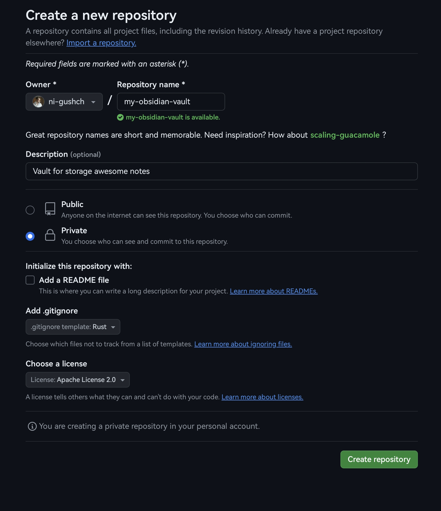
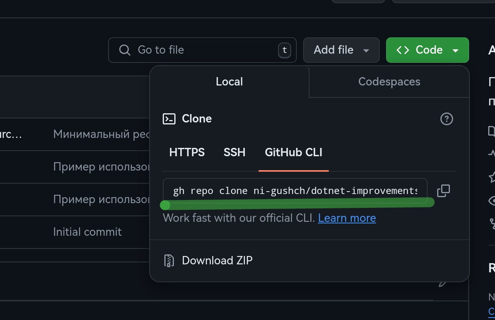
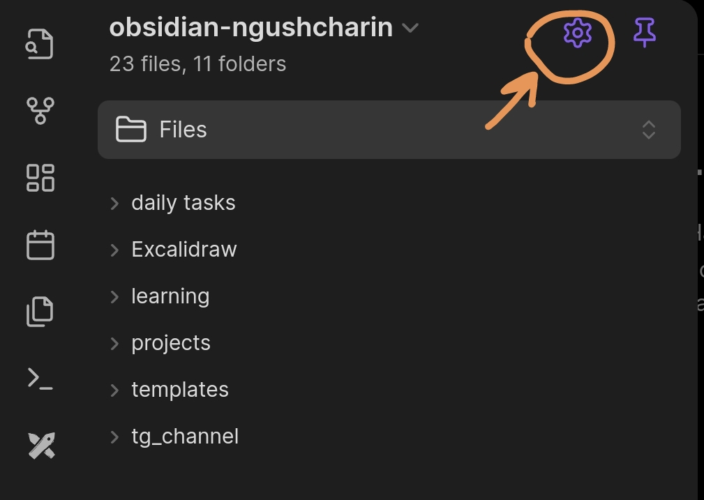
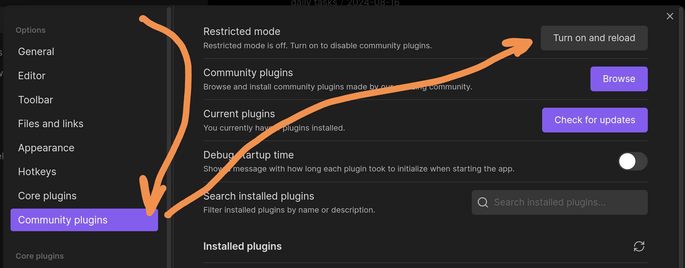
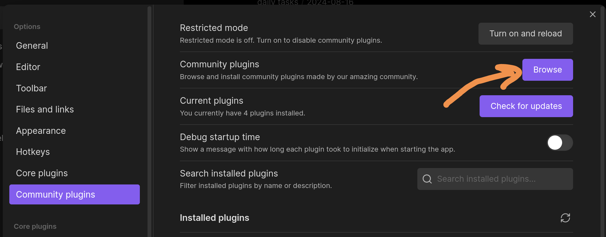
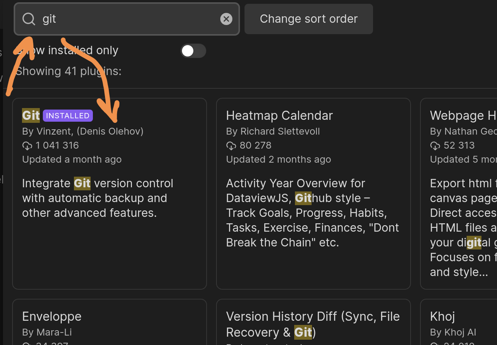
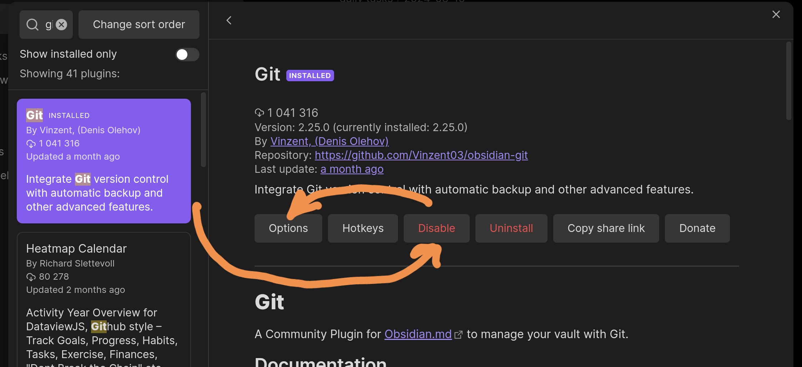
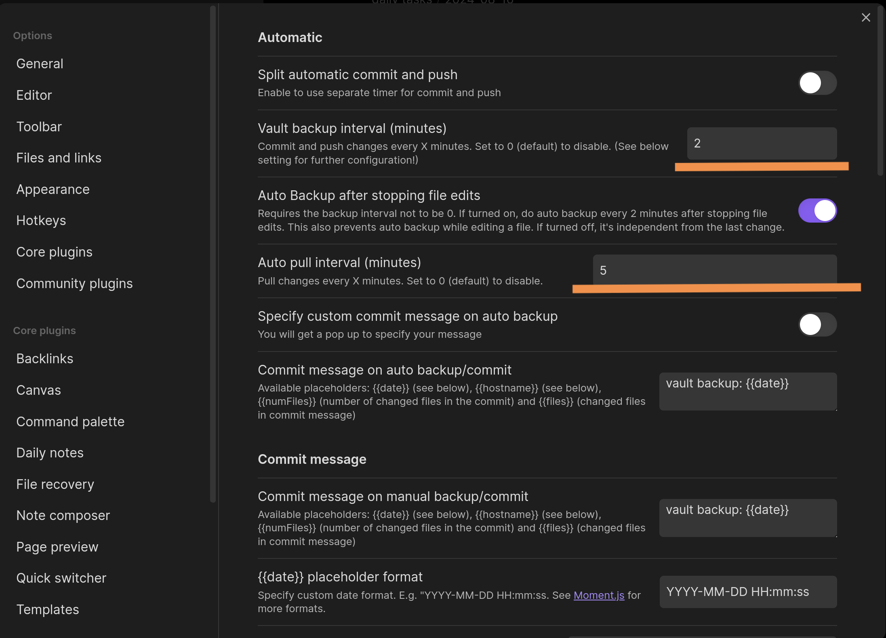
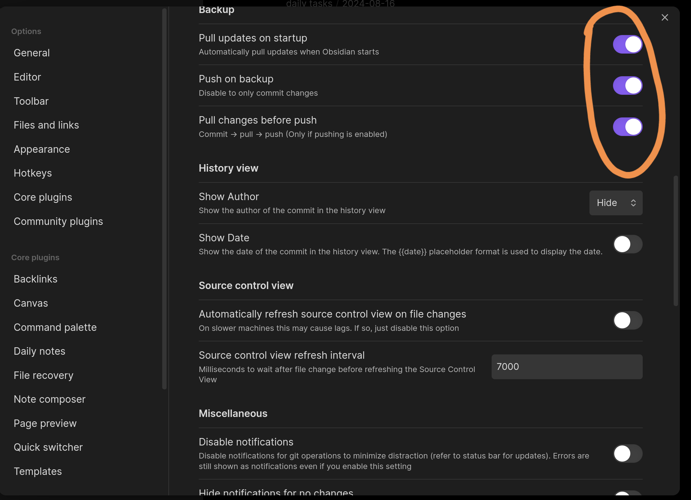
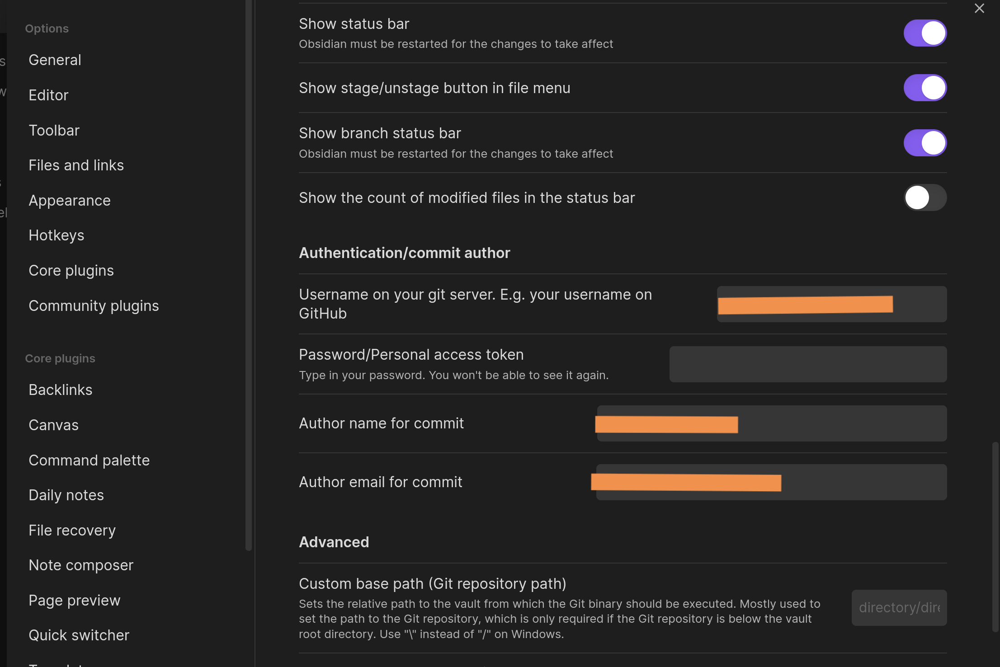

+++
title = "Obsidian. Git sync on Android."
description = "Ways to sync your Obsidian vaults on Android devices via Git."
date = 2024-08-18
updated = 2026-11-01
taxonomies = { tags = ["obsidian","git"], categories = [] }

draft = false
in_search_index = true

[extra]
# badge = "NEW"  # Options: NEW, BETA, UPDATED, WIP
+++

**Obsidian** is a very handy tool for keeping all kinds of notes. You can jot down a simple to-do list for the day, and some people use it to write scripts or draft entire books.

But using it raises the question of syncing your data. Sure, you could use the cloud sync built by Obsidian's developers, but sometimes you want independence from "the corporations." And **Obsidian** can give you that option.

Options include the Self-hosted LiveSync plugin with a CouchDB server, or the Git version control system.

This article covers how to set up vault syncing via Git on Android devices.

Make a separate backup of your notes before setting things up. A private repository restricts access, but doesn't provide end-to-end encryption or replace backups.

## Preparation

Whichever approach we go with, we need a repository to store all the documents in. So head over to wherever you'll be creating the repository (GitLab, GitHub...), log in, and create an empty private repository. To get a branch created automatically, you can add a `.gitignore` file to the repo right away.



Next we need to clone that repository onto the Android device somehow. Android has a system shell, but doesn't include a regular user terminal with Git. So we'll use a third-party app.

### Installing Termux and setting up Git

**Termux** is an open-source terminal app and Linux environment with a package manager. For this guide, use [F-Droid](https://f-droid.org/packages/com.termux/) or the official GitHub repository. The Google Play version is developed separately and has limitations. See the [official installation guide](https://github.com/termux/termux-app#installation) for current options. Install Termux and its Android add-ons from the same source: builds from different sources have different signatures.

Now let's launch the app and start installing the packages we need.

```sh
pkg update && pkg upgrade -y && pkg install -y git openssh termux-api
```

Then enable access to Android shared storage:

```sh
termux-setup-storage
```

Grant file access when prompted. This command creates the links under `~/storage` used below. The `termux-api` package is needed for the Tasker script later on; ordinary Git doesn't require it, and it doesn't replace the Android Termux:API app.

Next, let's decide which folder our vault repositories will live in. As an example, we'll create a `repos` folder inside `Documents`.

```sh
mkdir -p ~/storage/shared/Documents/repos/obsidian
cd ~/storage/shared/Documents/repos/obsidian
```

Now we need to clone the repository into the folder we just created.

If our repository were public, there'd be no issue. But ours is private, so cloning it requires authentication first.

For GitHub, you can use their official CLI app, `gh`. To install it, run:

```sh
pkg install gh
```

To authenticate on the website, use:

```sh
gh auth login --hostname github.com --git-protocol https
gh auth setup-git
```

You'll need to pick an authentication method. I usually go with the browser option… After choosing your settings, open the specified page and enter the code generated in the console. Don't share this code or your tokens with anyone.

Once connected, you'll get a link that looks like this:



Running it in the Termux console will clone the repository into whatever folder you're currently in.

```sh
gh repo clone OWNER/REPOSITORY
```

Replace `OWNER/REPOSITORY` with your repository's owner and name.

### Adding the vault to Obsidian

Once the repository is cloned, we can add that folder as a vault in Obsidian.

If you just downloaded the app, you'll see a "Choose folder as vault" button on the start screen. Tap it and point it at the folder that was created when the repository was cloned. The label may differ in your version.

You can now stage files in Git and push them to the remote repository. Git doesn't do this automatically: you need `git add` and `git commit`, or the equivalent plugin actions.

That wraps up the preparation stage. Now let's look at the actual syncing methods.

## Using the Git plugin

The simplest approach to configure. However, the [developers warn](https://github.com/Vinzent03/obsidian-git#mobile-support-experimental) that mobile support is experimental and very unstable. Instead of the Git CLI, it uses the JavaScript library `isomorphic-git`. The mobile version doesn't support SSH authentication or rebase, and large repositories can hang or run out of memory.

It didn't work for me on the first try. But after successfully setting up sync via the command line, the plugin started working. I think that was just a coincidence. Let's walk through the steps.

### Installing the plugin

The screenshots below are from the original article: the interface and setting names may have changed.

The plugin is developed by the community, so it's not part of `CorePlugins`. You first need to enable `Community plugins` support. To do that, tap the gear icon in the top-right corner of the menu.



Then enable `Community plugins` support, as shown in the screenshot.



Next, tap to browse the list of available plugins.



And search the list for a plugin named `Git`.



Tap the plugin -> Install -> Enable. The enable button will be in the same spot where the screenshot shows a "disable" button.



Next, head into the plugin's settings. I set the automatic repository update interval to: commit changes every 2 minutes, check for updates every 5 minutes. Since we're really only working on one device at a time, there's no need for instant updates.



Enable checking for updates on app startup, pushing changes after a local commit, and updating the local repository before pushing to the remote one (Pull before Push).



You'll also need to configure HTTPS authentication: for GitHub, use a Personal Access Token from your GitHub user settings rather than your account password. Restrict it to the relevant repository and the minimum content read/write permissions. The mobile plugin doesn't automatically inherit your `gh` login from Termux. Separately, enter the Git commit author's name and email: these aren't login credentials.



The plugin will now attempt to update your vault's repository automatically. You'll notice pop-up notifications describing sync actions. Check for errors: update intervals alone don't prevent conflicts.

Don't commit the plugin's token: check its settings and exclude `.obsidian/plugins/obsidian-git/data.json` through `.gitignore` if that's where it stores the token. Revoke any token already committed to history. Don't run the plugin and external Git automation against the same vault at the same time.

## Using the Termux terminal

We're almost all set to implement this approach. We need to set your name and email. If you selected HTTPS and configured `gh` above, an SSH key isn't required. Open Termux and run these commands, replacing the name and email with yours:

```sh
git config --global user.name "Your Name"
git config --global user.email "you@example.com"
```

If you prefer SSH, first generate a key if you don't already have a suitable one, then display its public part. Don't overwrite an existing key:

```sh
ssh-keygen -t ed25519
cat ~/.ssh/id_ed25519.pub
```

Copy the public key, go to your user settings on GitHub or whichever repository host you use, and add it as an authentication SSH key. Keep the private key in Termux's `~/.ssh`, not shared storage. On the first connection, check the server's key fingerprint against your Git host's documentation. SSH also needs an `origin` URL such as `git@github.com:OWNER/REPOSITORY.git`: having a key doesn't switch an HTTPS repository to SSH. This SSH URL won't work with the mobile Git plugin.

The downside of this approach is that there's no automation at all — you'll have to type every command by hand. But on the plus side, you can see which step went wrong :D

Go into the folder where your vault lives:

```sh
cd ~/storage/shared/Documents/repos/obsidian/my-obsidian-vault-repo
```

Replace `my-obsidian-vault-repo` with your folder's name. Before editing notes, check the state and retrieve changes with a clean working tree:

```sh
git status
git fetch --prune
git pull --ff-only
```

If the branches have diverged or local changes prevent the update, stop and resolve the situation rather than blindly continuing. `--ff-only` doesn't automatically reconcile diverging histories.

> Note: `prune` removes stale remote-tracking references, not files from the index. To enable it for `origin` in the current repository, use:
>
> ```sh
> git config remote.origin.prune true
> ```

Once your local copy is synced with the remote one and you've added new files, you can push those changes to the remote repository. To do that, run:

```sh
git status
git diff
git add .
git diff --cached
git commit -m "Update notes"
git push
```

If there are no changes, no commit is needed. If a push is rejected because new remote commits appeared, save your work first, then merge or rebase separately and resolve any conflicts. Don't use `push --force` or `reset --hard` as a generic sync fix.

That's how you can update the data in the remote repository by hand. But this approach isn't exactly convenient. Let's try to improve on it.

## Using Termux with the Tasker scheduler

For this approach, follow the **Termux Setup** and **Tasker Setup** sections of [this guide](https://github.com/DovieW/obsidian-android-sync/blob/master/README.md). Review them in full: besides the `termux-api` package, you'll need the Android Termux:API and Termux:Tasker apps, permissions, and SSH configuration.

The current script contains hard-coded paths. Start by cloning it to the location in its README:

```sh
git clone https://github.com/DovieW/obsidian-android-sync.git ~/storage/shared/repos/obsidian-android-sync
```

For the vault in this article, adjust the paths in the script configuration and Tasker: upstream expects vaults under `/storage/emulated/0/repos/Obsidian`, while ours are in `Documents/repos/obsidian`. Don't run setup blindly: at the time of checking, it globally sets `safe.directory=*`, disabling Git's ownership checks for all repositories. Prefer allowing only specific, verified paths. Read the script and test it on a copy of your vault first.

The **upside** of this method is potential full automation, if you get all the settings right. And even if you can't get the Tasker app working, you're still left with a script you can call manually to sync your vault.

```sh
sync
```

After the project's full setup, the `sync` alias runs its vault-syncing script. Without that setup, the ordinary system `sync` command has nothing to do with Git. The script attempts to retrieve changes, commit, and push; success depends on authentication and the absence of unresolved conflicts.

The **downside** of this approach is that the **Tasker** app is PAID! And why would we want to handle syncing ourselves and pay for an app on top of that? But if you already own it, this method is for you.

## Using Termux with the cron scheduler

There's one more approach, which is really just an alternative to the previous one. Here we swap out the Tasker app for cron's scheduling capabilities. You can run and manage it right from within **Termux** itself.

To set this up, you can follow [this guide](https://www.reddit.com/r/ObsidianMD/comments/qep4gn/guide_obsidian_vault_github_sync_cron_on_termux/). You can reuse the same script we got from the previous method.

With cron, you can very flexibly configure your sync schedule.

However, cron only works while its daemon is running. Android may stop Termux in the background, so a schedule doesn't guarantee syncing: check battery restrictions and startup after reboot on your device.

That's it. We've covered a few ways to set up vault syncing through a Git repository.

If you still have questions, feel free to ask them under the posts in the [tg channel](https://t.me/bald_man_gushcharin).

### Sources and currency

Technical corrections were checked against documentation on November 1, 2026; the setup wasn't repeated on an Android device.

- [Termux installation and build limitations](https://github.com/termux/termux-app#installation)
- [GitHub CLI authentication](https://cli.github.com/manual/gh_auth_login)
- [Obsidian Git mobile limitations](https://github.com/Vinzent03/obsidian-git#mobile-support-experimental)
- [Obsidian Android Sync: current instructions and scripts](https://github.com/DovieW/obsidian-android-sync)
- [Git: retrieving and integrating changes](https://git-scm.com/docs/git-pull)
