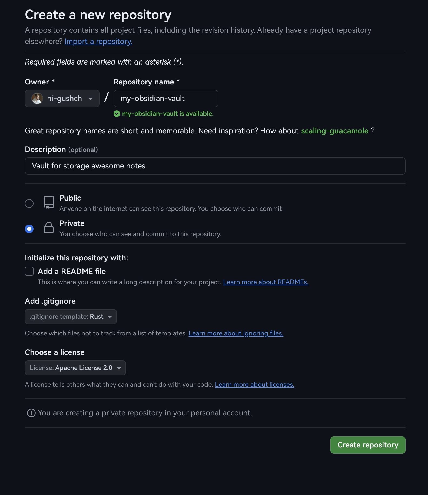
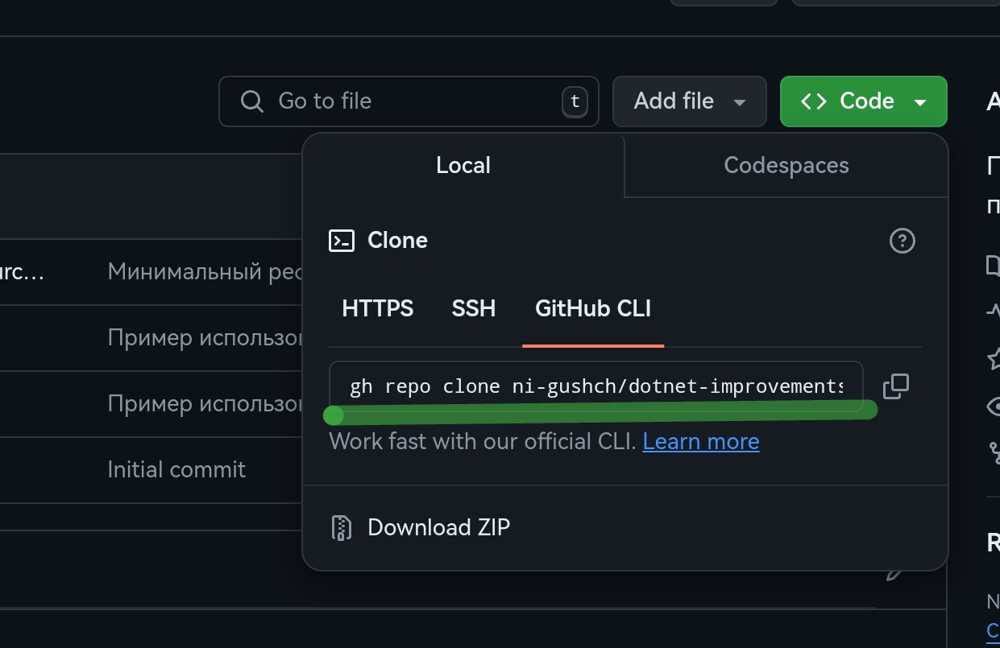
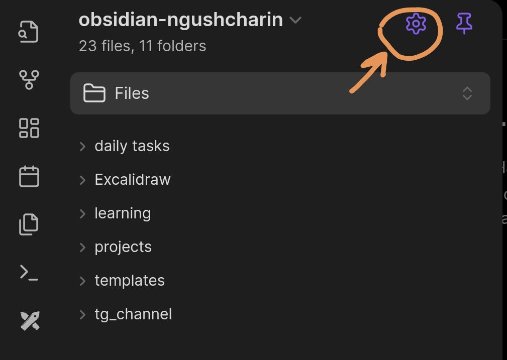
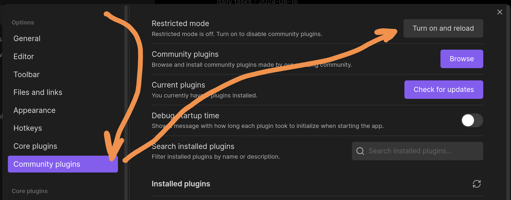
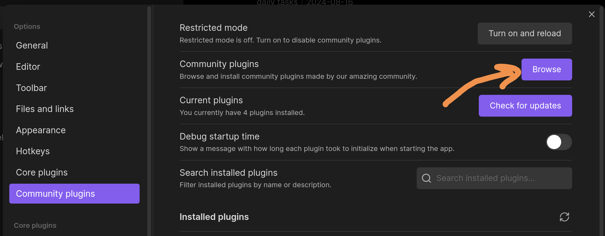
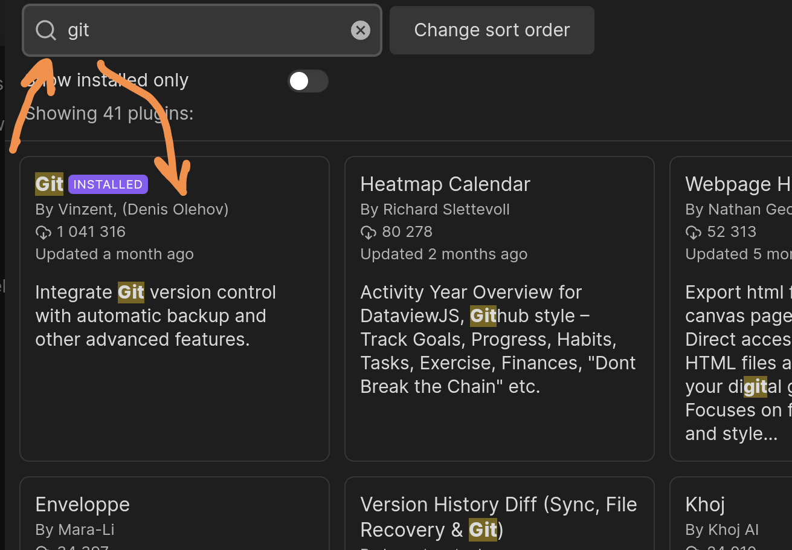
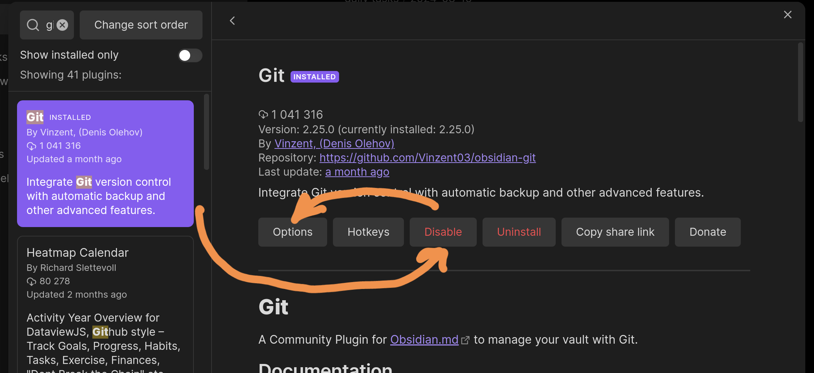
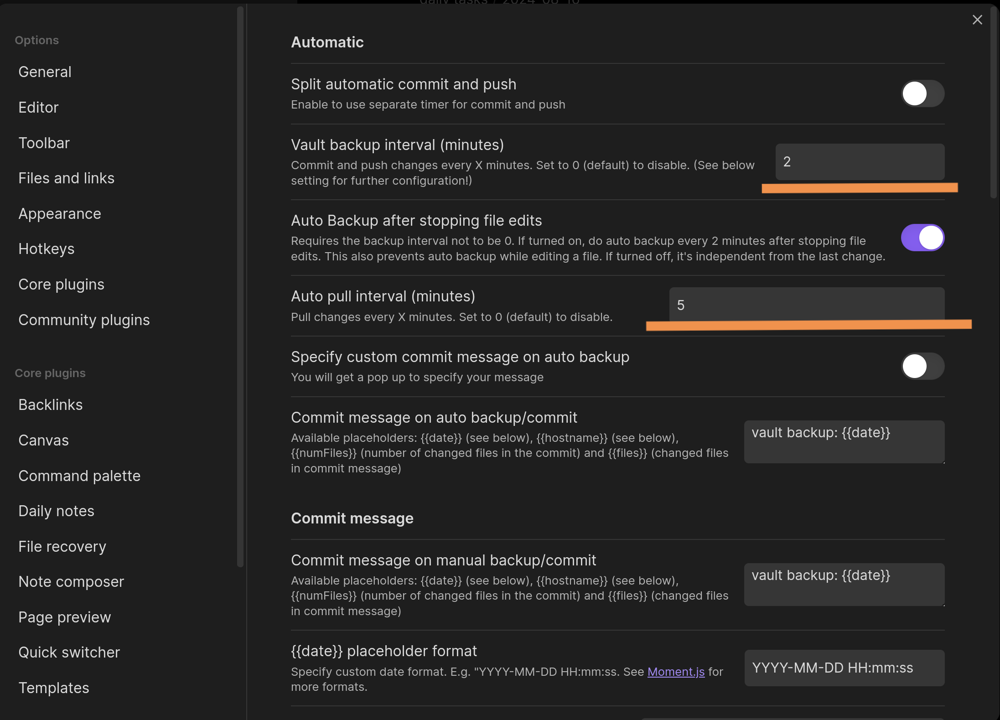
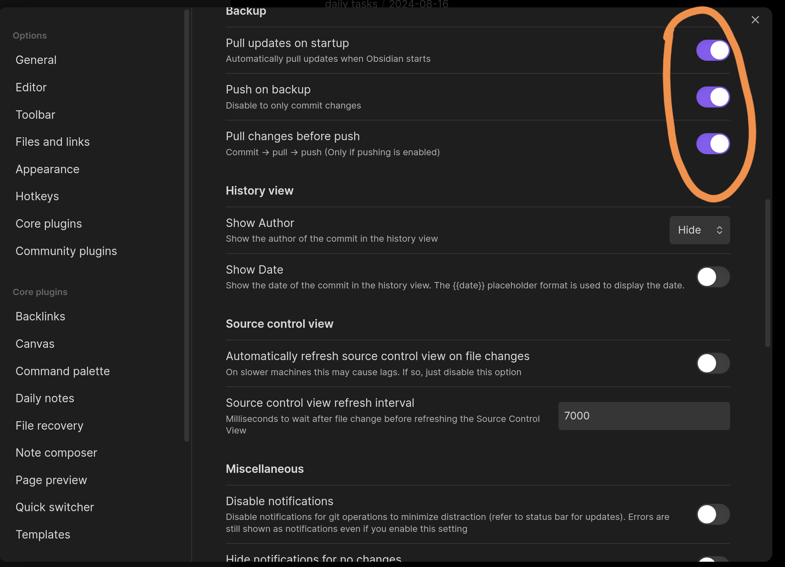
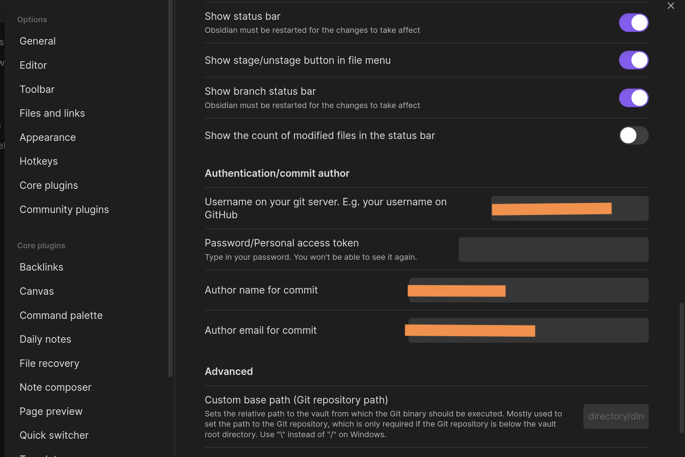

+++
title = "Obsidian. Git-синхронизация на Android."
description = "Способы синхронизации хранилищ Obsidian на Android-устройствах через Git."
date = 2024-08-18
updated = 2026-11-01
taxonomies = { tags = ["obsidian","git"], categories = [] }

draft = false
in_search_index = true

[extra]
# badge = "NEW"  # Options: NEW, BETA, UPDATED, WIP
+++

**Obsidian** — очень удобный инструмент для работы с заметками разного рода. Можно составлять просто список дел на день, а некоторые люди пишут сценарии или наброски книг.

Но при его использовании встаёт вопрос о синхронизации данных. Конечно, можно использовать облачную синхронизацию от разработчиков Obsidian, но иногда хочется получить независимость от «корпораций». И **Obsidian** может предоставить такой вариант.

Среди вариантов — плагин Self-hosted LiveSync с сервером CouchDB или система контроля версий Git.

В этой статье пойдёт речь о том, как реализовать синхронизацию хранилища через Git на Android-устройствах.

Перед настройкой сделайте отдельную резервную копию заметок. Приватный репозиторий ограничивает доступ, но не даёт сквозного шифрования и не заменяет бэкап.

## Подготовительный этап

Для реализации любого способа нам обязательно нужен репозиторий, в котором будут храниться все документы. Для этого заходим туда, где будем создавать репозиторий (GitLab, GitHub...), логинимся и создаём пустой приватный репозиторий. Чтобы автоматически создалась ветка, можно сразу добавить в репозиторий файл `.gitignore`.



Далее нам нужно как-то клонировать этот репозиторий на Android-устройство. В Android есть системная оболочка, но нет привычного пользовательского терминала с Git. Поэтому воспользуемся сторонним приложением.

### Установка Termux и настройка Git

**Termux** — приложение с открытым исходным кодом: терминал и Linux-окружение с пакетным менеджером. Для этой инструкции лучше установить его из [F-Droid](https://f-droid.org/packages/com.termux/) или официального GitHub-репозитория. Версия из Google Play развивается отдельно и имеет ограничения. Актуальные варианты установки описаны в [официальной инструкции](https://github.com/termux/termux-app#installation). Termux и его Android-дополнения устанавливайте из одного источника: у разных сборок отличаются подписи.

Теперь запускаем приложение и начинаем устанавливать необходимые пакеты.

```sh
pkg update && pkg upgrade -y && pkg install -y git openssh termux-api
```

Затем разрешаем доступ к общему хранилищу Android:

```sh
termux-setup-storage
```

Подтвердите разрешение на доступ к файлам. Эта команда создаст ссылки в `~/storage`, которые используются ниже. Пакет `termux-api` понадобится для скрипта в разделе Tasker; для обычной работы Git он не обязателен и не заменяет Android-приложение Termux:API.

Теперь определим, в какой папке будут расположены репозитории Vaults. Для примера создадим папку `repos` в папке `Documents`.

```sh
mkdir -p ~/storage/shared/Documents/repos/obsidian
cd ~/storage/shared/Documents/repos/obsidian
```

Теперь нам нужно клонировать репозиторий в созданную папку.

Если бы у нас репозиторий был публичный, проблем бы не было. Но у нас он приватный, и чтобы клонировать его, нужно пройти авторизацию.

Для GitHub можно воспользоваться их фирменным CLI-приложением `gh`. Чтобы его установить, нужно выполнить команду:

```sh
pkg install gh
```

Для авторизации на сайте можно использовать:

```sh
gh auth login --hostname github.com --git-protocol https
gh auth setup-git
```

Нужно будет выбрать способ прохождения авторизации. Я обычно выбираю через браузер… После выбора параметров нужно будет открыть указанную страницу и ввести код, сгенерированный в консоли. Не передавайте этот код и токены другим людям.

После подключения можно будет получить ссылку такого вида:



И, выполнив её в консоли Termux, репозиторий будет клонирован в ту папку, в которой мы сейчас находимся.

```sh
gh repo clone OWNER/REPOSITORY
```

Вместо `OWNER/REPOSITORY` укажите владельца и имя своего репозитория.

### Добавление хранилища в Obsidian

После клонирования репозитория мы можем добавить эту папку как хранилище в Obsidian.

Если вы только скачали само приложение, на стартовом экране у вас появится кнопка «Выбор папки для хранилища». Нажав её, укажите ту папку, которая была создана в результате клонирования репозитория. Название кнопки может отличаться в вашей версии.

Теперь файлы можно добавлять в индекс Git и отправлять в удалённый репозиторий. Сам Git не делает этого автоматически: нужны команды `git add` и `git commit` либо действия плагина.

С подготовительным этапом закончили. Теперь рассмотрим способы именно синхронизации.

## Использование расширения Git

Самый простой по настройке способ. Но [разработчики предупреждают](https://github.com/Vinzent03/obsidian-git#mobile-support-experimental), что на мобильных устройствах расширение экспериментальное и крайне нестабильное. Вместо Git CLI оно использует JavaScript-библиотеку `isomorphic-git`. В мобильной версии нет SSH-аутентификации и rebase; большие репозитории могут приводить к зависаниям или нехватке памяти.

У меня получилось запустить его не с первого раза. Но после удачной попытки настроить синхронизацию через командную строку расширение заработало. Я думаю, что это было просто совпадение. Давайте пройдём по шагам.

### Установка расширения

Скриншоты ниже сохранены из первоначальной версии статьи: интерфейс и названия настроек могут отличаться.

Плагин разрабатывается сообществом, и поэтому его нет в составе `CorePlugins`. Нужно сначала включить поддержку `Community plugins`. Для этого нажмите на шестерёнку в правом верхнем углу меню.



После включаем поддержку `Community plugins`, как показано на рисунке.



Далее нажимаем на просмотр списка доступных расширений.



И ищем среди списка расширение с названием `Git`.



Нажимаем на это расширение → «Установить» → «Активировать». Кнопка «Активировать» будет там, где на картинке кнопка «Отключить».



Далее переходим в настройки плагина. Я установил время автоматического обновления репозитория: коммит изменений каждые 2 минуты, проверка обновлений каждые 5 минут. Так как мы всё-таки работаем одновременно на одном устройстве, не обязательно делать мгновенное обновление.



Включаем проверку обновления при старте приложения, Push изменений после локальной фиксации и обновление локального репозитория перед отправкой в удалённый (Pull before Push).



Также нужно настроить HTTPS-аутентификацию: для GitHub вместо пароля аккаунта используется Personal Access Token, который можно получить в настройках пользователя GitHub. Ограничьте его нужным репозиторием и минимальными правами на чтение и запись содержимого. Авторизация `gh` в Termux не передаётся мобильному плагину автоматически. Отдельно вводим имя и почту автора коммитов Git — это не данные для входа.



Теперь плагин будет пытаться автоматически обновлять репозиторий хранилища. Вы можете заметить всплывающие окна с описанием действий синхронизации. Проверяйте ошибки: интервалы обновления сами по себе не предотвращают конфликты.

Не коммитьте токен плагина: проверьте его настройки и исключите `.obsidian/plugins/obsidian-git/data.json` через `.gitignore`, если токен хранится там. Уже попавший в историю токен нужно отозвать. Не запускайте плагин и внешнюю Git-автоматизацию одновременно над одним хранилищем.

## Использование терминала Termux

Для реализации этого подхода у нас почти всё готово. Нужно прописать имя пользователя и адрес электронной почты. Если выше вы выбрали HTTPS и настроили `gh`, SSH-ключ не обязателен. Заходим в приложение Termux и запускаем команды, заменив имя и почту своими:

```sh
git config --global user.name "Your Name"
git config --global user.email "you@example.com"
```

Если предпочитаете SSH, сначала создайте ключ, если подходящего ещё нет, а затем выведите его публичную часть. Не перезаписывайте существующий ключ:

```sh
ssh-keygen -t ed25519
cat ~/.ssh/id_ed25519.pub
```

Скопируйте публичный ключ, идите в настройки пользователя GitHub или другого репозитория и добавьте SSH-ключ авторизации. Закрытый ключ оставьте в `~/.ssh` Termux, не в общем хранилище. При первом соединении сверяйте отпечаток ключа сервера с документацией Git-хостинга. Для SSH также нужен адрес `origin` вида `git@github.com:OWNER/REPOSITORY.git`: наличие ключа не переключает HTTPS-репозиторий на SSH. С мобильным плагином Git такой SSH-адрес использовать нельзя.

Минус этого подхода в том, что тут не будет никакой автоматики, и придётся прописывать все команды вручную. Но зато видно, на каком шаге что-то пошло не так :D

Заходим в папку, где находится наше хранилище:

```sh
cd ~/storage/shared/Documents/repos/obsidian/my-obsidian-vault-repo
```

Замените `my-obsidian-vault-repo` именем своей папки. Перед редактированием заметок проверяем состояние и получаем изменения при чистом рабочем каталоге:

```sh
git status
git fetch --prune
git pull --ff-only
```

Если ветки разошлись или есть мешающие локальные изменения, остановитесь и разберитесь с ними, а не продолжайте команды вслепую. `--ff-only` не объединяет разошедшиеся истории автоматически.

> Заметка: `prune` удаляет устаревшие ссылки на удалённые ветки, а не очищает индекс файлов. Чтобы включить это для `origin` в текущем репозитории, можно использовать настройку:
>
> ```sh
> git config remote.origin.prune true
> ```

После синхронизации локальной копии с удалённой и добавления новых файлов можно отправить эти изменения в удалённый репозиторий. Для этого выполним следующее:

```sh
git status
git diff
git add .
git diff --cached
git commit -m "Update notes"
git push
```

Если изменений нет, коммит не нужен. Если push отклонён из-за новых удалённых коммитов, сначала сохраните свою работу, затем отдельно объедините изменения через merge или rebase и разрешите конфликты. Не используйте `push --force` или `reset --hard` как универсальное исправление синхронизации.

Вот так вручную можно обновлять данные в удалённом репозитории. Но этот способ не такой удобный. Давайте попробуем его улучшить.

## Использование Termux и отдельного планировщика Tasker

Для этого способа можно воспользоваться [этой инструкцией](https://github.com/DovieW/obsidian-android-sync/blob/master/README.md), разделами **Termux Setup** и **Tasker Setup**. Проверьте их целиком: кроме пакета `termux-api`, нужны Android-приложения Termux:API и Termux:Tasker, разрешения и настройка SSH.

В текущем скрипте есть жёстко заданные пути. Для начала клонируйте его по пути из README:

```sh
git clone https://github.com/DovieW/obsidian-android-sync.git ~/storage/shared/repos/obsidian-android-sync
```

Для хранилища из этой статьи нужно отдельно согласовать пути в конфигурации скрипта и Tasker: upstream ожидает хранилища в `/storage/emulated/0/repos/Obsidian`, а у нас они в `Documents/repos/obsidian`. Не запускайте setup вслепую: на дату проверки он добавляет глобальное `safe.directory=*`, отключая проверку владельца всех Git-репозиториев. Лучше разрешать только проверенные конкретные пути. Сначала изучите скрипт и проверьте его на копии хранилища.

**Плюс** этого метода — потенциальная автоматизация, если правильно пройти все настройки. Если же не получится поработать с приложением Tasker, то останется скрипт, который можно вызывать для синхронизации хранилища.

```sh
sync
```

После полной настройки проекта алиас `sync` запускает его скрипт синхронизации хранилищ. Без этой настройки обычная системная команда `sync` не имеет отношения к Git. Скрипт пытается получить изменения, сделать коммит и отправить его; успешный результат зависит от авторизации и отсутствия неразрешённых конфликтов.

**Минус** этого подхода — приложение **Tasker** — ПЛАТНОЕ!!! А зачем нам использовать синхронизацию собственными руками, да ещё и платить за приложение? Но если оно уже у вас есть, то этот способ для вас.

## Использование Termux и планировщика cron

Есть ещё один способ, который просто является альтернативой для предыдущего. В этом варианте мы заменяем приложение Tasker на возможности cron scheduler. Запускать и управлять им можно прямо в самом **Termux**.

Для реализации такого подхода можно воспользоваться [этой инструкцией](https://www.reddit.com/r/ObsidianMD/comments/qep4gn/guide_obsidian_vault_github_sync_cron_on_termux/). Но в качестве скрипта можно использовать тот, который мы получили в результате предыдущего способа.

С помощью cron можно очень гибко настроить время синхронизации.

Но cron работает, только пока запущен его демон. Android может остановить Termux в фоне, поэтому расписание не гарантирует синхронизацию: проверьте ограничения батареи и запуск после перезагрузки на своём устройстве.

На этом всё. Мы рассмотрели несколько способов реализации синхронизации хранилища через Git-репозиторий.

Если остались вопросы, то можно задать их под постами в [tg канале](https://t.me/bald_man_gushcharin).

### Источники и актуальность

Технические уточнения проверены 1 ноября 2026 года по документации; повторная настройка на Android-устройстве не проводилась.

- [Termux: установка и ограничения сборок](https://github.com/termux/termux-app#installation)
- [GitHub CLI: авторизация](https://cli.github.com/manual/gh_auth_login)
- [Obsidian Git: ограничения мобильной версии](https://github.com/Vinzent03/obsidian-git#mobile-support-experimental)
- [Obsidian Android Sync: текущая инструкция и скрипты](https://github.com/DovieW/obsidian-android-sync)
- [Git: получение и объединение изменений](https://git-scm.com/docs/git-pull)
